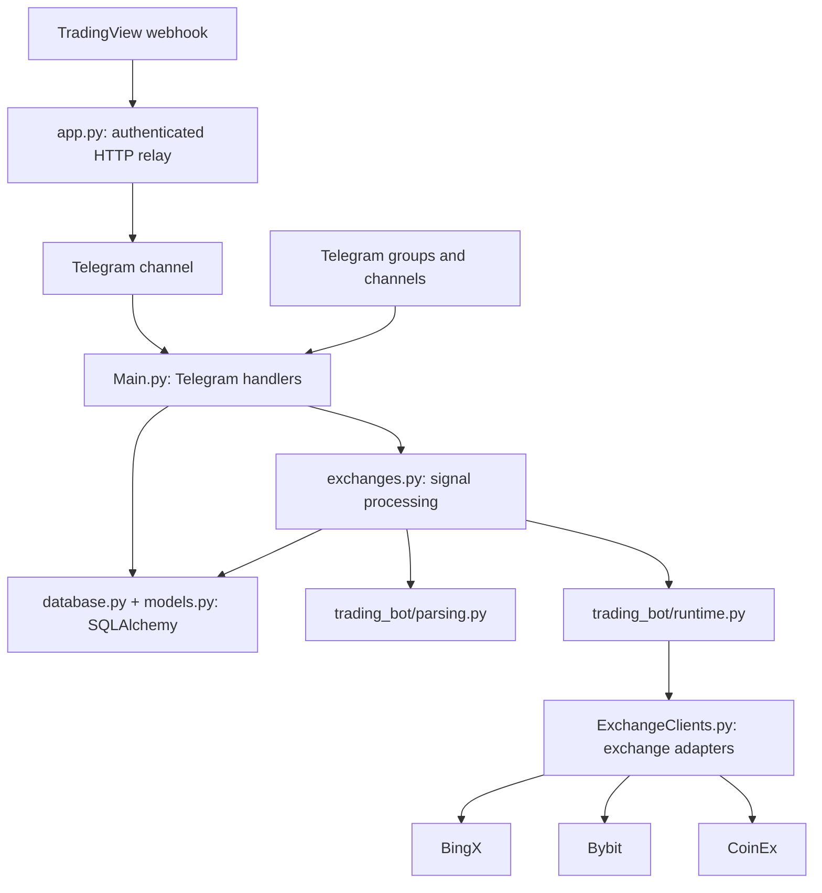

# Architecture

The diagram reflects inspected source modules, not a proposed deployment.

The existing bot also provides management, subscription, referral, and report
flows. Main.py has a large state machine and writes to the database at module
import time. The database contents and schema have not been migrated.

## Critical boundaries

1. External TradingView payloads are parsed into validated mappings without
   calling `eval()`. Each user signal still requires its own stored secret.
2. `exchanges.py` explicitly checks the live-trading guard before activating
   an exchange adapter for order placement.
3. `app.py` validates an independent relay secret before forwarding alerts.
4. Tests can substitute a network sender and policy settings without making
   production calls.

## Next structural step

After regression coverage of the conversation state machine and persisted
database models exists, move the legacy handlers and exchange clients into
cohesive modules, keeping compatibility shims for the existing entry points.
A blanket directory move today would risk breaking runtime imports and data.
